# PersonaDrive: more information

[← Back to the main README](../README.md)

## Same weights, different style database

Each pair is **the same checkpoint on the same Bench2Drive route**. The only difference is whether the retrieval head queries the *aggressive* or the *conservative* database of human demonstrations. Clips are sped up 1.3–1.5×.

<p align="center">
<a href="https://pervasiveautonomylab.github.io/personadrive-landpage/static/videos/style_cyclist.mp4">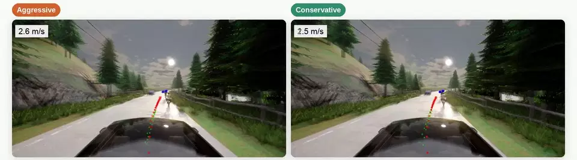</a><br>
<sub><b>Overtaking a cyclist.</b> The aggressive agent passes at the first gap in oncoming traffic and reaches 18.6 m/s; the conservative agent stays behind the cyclist and passes once the road is clear.</sub>
</p>

<p align="center">
<a href="https://pervasiveautonomylab.github.io/personadrive-landpage/static/videos/style_merge.mp4">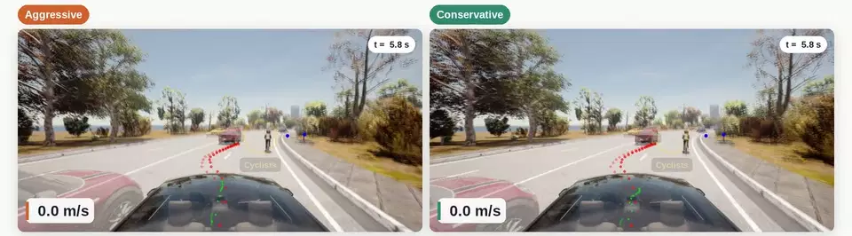</a><br>
<sub><b>Cyclists blocking the lane.</b> Both agents stop and wait to merge left. The aggressive agent takes the first gap behind a passing car; the conservative agent merges about 16 s later, once the lane is open.</sub>
</p>

<p align="center">
<a href="https://pervasiveautonomylab.github.io/personadrive-landpage/static/videos/style_turn.mp4">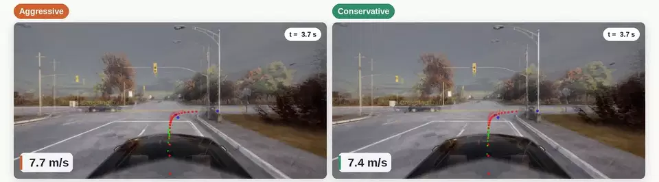</a><br>
<sub><b>Right turn with crossing traffic.</b> The aggressive agent turns into the first gap; the conservative agent lets more cars pass and turns about 5 s later.</sub>
</p>

## How it works

<p align="center">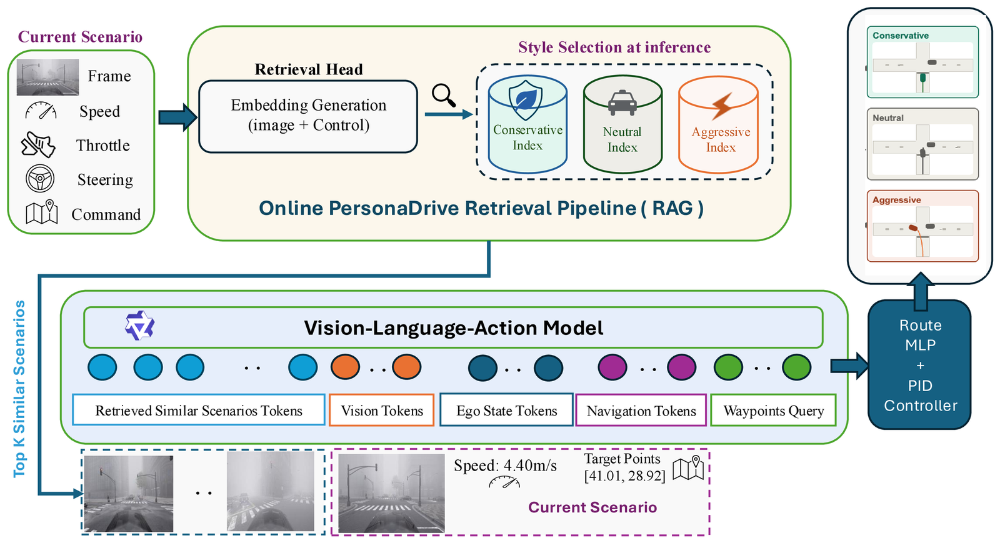</p>

**Offline:** the frames of each style are stored in their own FAISS index.

**Online, at every tick:**
1. The retrieval head encodes the current scene.
2. It queries the index of the selected style and returns the *K* most similar **context points**: image, control history, command, target points, commentary, and executed waypoints.
3. These are placed before the current observation in the prompt of the VLA backbone.
4. The backbone's waypoints are decoded by the Route MLP and turned into steering, throttle and brake by a PID controller.

| | Stage | What happens | Code |
|:-:|---|---|---|
| **1** | **Triplet mining** | Each frame becomes a structured *frame sentence* (ego state, command, VQA, commentary, executed waypoints). A combined SigLIP image + BGE-M3 sentence similarity selects positives, easy negatives and **hard negatives**: frames that look alike but where the driver used a different command. | [`persona_drive_rag/`](../persona_drive_rag/README.md) |
| **2** | **Retrieval head** | Frozen SigLIP features (768-d) ⊕ a trained `ControlEncoder` over the vehicle state and command (128-d) are projected to a 1024-d embedding and trained with a triplet loss. One head serves all styles; one FAISS index per style. | [`embed_training.py`](../persona_drive_rag/embed_training.py), [`build_faiss_index.py`](../persona_drive_rag/build_faiss_index.py) |
| **3** | **In-context SFT** | The VLA backbone (InternVL2-1B, from SimLingo) is LoRA-fine-tuned to read the **K = 2** retrieved context points as few-shot demonstrations. It gets **no style label** and has to infer the style from the demonstrations. | [`scripts/training/generate_icl_examples.py`](../scripts/training/generate_icl_examples.py), [`personadrive_icl_sft.yaml`](../simlingo_training/config/experiment/personadrive_icl_sft.yaml) |

<details>
<summary><b>Inside the retrieval head</b> (click to expand)</summary>
<br>

```
image    : front camera ─► SigLIP ViT-B/16 (frozen) ───────────────────────► 768-d ────────────────────────────┐
sensors  : speed, throttle, steering, brake ─► LayerNorm ─► MLP 4→32→32 ───► 32-d ┐                            │
command  : navigation command (6 values) ─► learned embedding ─────────────► 16-d ┴─► Linear+GELU+LN ─► 128-d ─┤
fusion   : concat 896-d ─► Projection MLP 896→1024→1024 ─► L2-normalise ─► 1024-d embedding ◄──────────────────┘
```

- **What is trained.** The control encoder and the projection MLP, about 2.0 M parameters. SigLIP (`google/siglip-base-patch16-224`) stays frozen.
- **Training objective.** A triplet loss on the Stage 1 triplets pulls each frame towards its positive and away from its hard and easy negatives. Hard negatives look like the anchor but were driven with a different command, so the sensor and command branch has to separate them from the image alone.
- **Index.** Every frame of a style database is embedded once, offline, into a FAISS `IndexFlatIP`. Inner product on unit vectors is cosine similarity. One head serves all styles, with one index per style.
- **At every tick.** The agent embeds the current camera frame, vehicle state and command, and takes the top K = 2 neighbours from the selected style's index. Embedding and lookup take about 20 ms per tick.
- **Code.**
  - `ControlEncoder` and `ProjectionMLP` in [`persona_drive_rag/embed_training.py`](../persona_drive_rag/embed_training.py);
  - the index builder [`persona_drive_rag/build_faiss_index.py`](../persona_drive_rag/build_faiss_index.py);
  - online retrieval in [`simlingo_training/utils/icl_retrieval.py`](../simlingo_training/utils/icl_retrieval.py).

</details>

<details>
<summary><b>Triplet mining and mined examples</b> (click to expand)</summary>
<br>

Every frame of a style, the **anchor**, is compared with every other frame of that style in two ways:
- its camera image, by SigLIP cosine similarity;
- its frame sentence (ego state, navigation command, VQA, commentary, waypoints), by BGE-M3 cosine similarity.

The two are averaged (0.5 / 0.5) into one combined score. "Command" means the navigation command: Follow Lane, Go Left, Go Right, Go Straight, Change Lane Left or Change Lane Right. The thresholds below are percentiles measured on each style's own frames, so they adapt to the data.

| Example | Command vs. the anchor | How it is picked | Role in training |
|---|---|---|---|
| **Positive** | same | From the anchor's most similar frames by combined score, with image **and** sentence similarity above the 60th percentile of same-command pairs. The 6 most similar are kept. | Pulled towards the anchor. |
| **Hard negative** | different | Also from the anchor's most similar frames, with image **and** sentence similarity above the 30th percentile of different-command pairs (50th for `default` and `normal`). The 6 most similar are kept. | Pushed away. It looks and reads like the anchor, but the driver did something else, so an image-only head would rank it as a positive. |
| **Easy negative** | different | From the anchor's least similar frames, with image **and** sentence similarity below the 30th percentile of different-command pairs. 6 are drawn at random, never a frame already used as a hard negative. | Pushed away. Different scene and different command: the easy case. |

- **Pools:** "most similar" is the top 1,000 frames by combined score and "least similar" the bottom 200 (200 / 200 for `default` and `normal`).
- **Anchors:** an anchor is kept only if it has at least one positive, one hard negative and one easy negative.
- **No easy or hard positives:** every positive is chosen the same way.
- **Code:** `mine_triplets_vectorized` and `compute_adaptive_thresholds` in [`persona_drive_rag/embed_mine.py`](../persona_drive_rag/embed_mine.py). The thresholds of the released runs are in [`persona_drive_rag/provenance/thresholds/`](../persona_drive_rag/provenance/thresholds/).

<p align="center">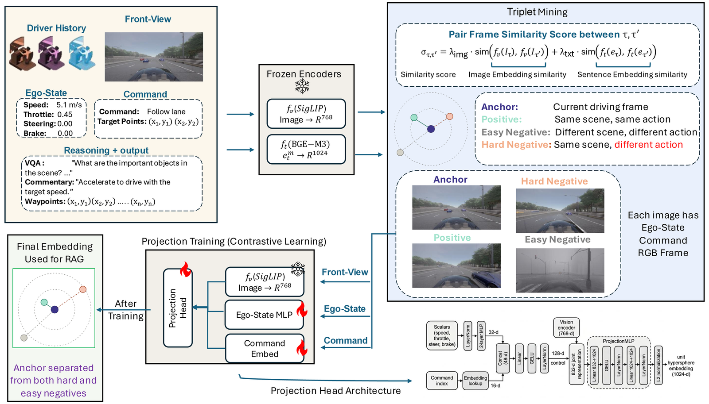</p>
<p align="center"><sub>Stage 1 mining and Stage 2 retrieval-head training. Hard negatives are visually similar to the anchor but diverge in command, so a head relying on images alone would rank them as positives.</sub></p>
<p align="center">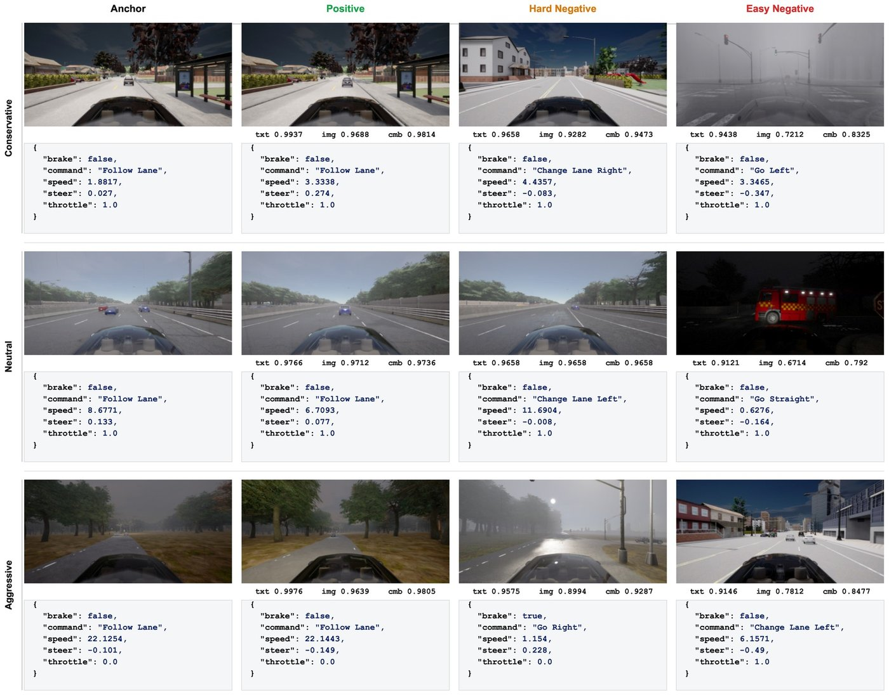</p>
<p align="center"><sub>Mined (anchor, positive, hard negative, easy negative) quadruples for each style. Inspect your own with <code>persona_drive_rag/triplet_viewer/app_v2.py</code>.</sub></p>
</details>

## Retrieval in action

<p align="center">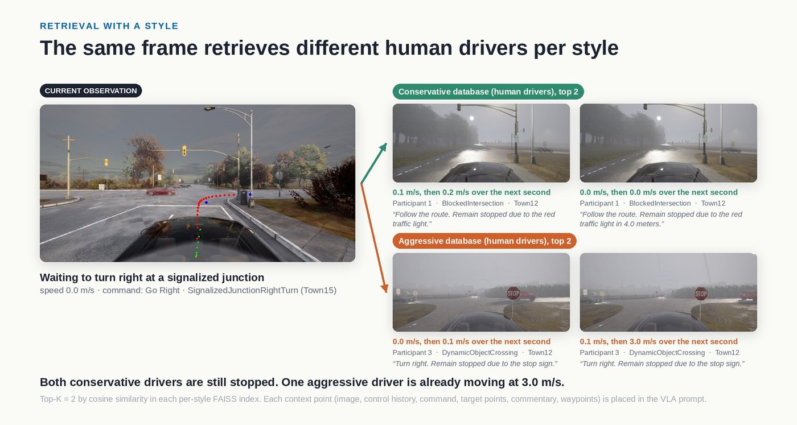</p>
<p align="center"><sub><b>Conservative vs. aggressive.</b> The same Bench2Drive frame retrieves different human drivers. Both conservative drivers are still stopped at the junction; one aggressive driver is already moving at 3.0 m/s.</sub></p>

<p align="center">
<a href="https://pervasiveautonomylab.github.io/personadrive-landpage/static/videos/drive_context_rain.mp4">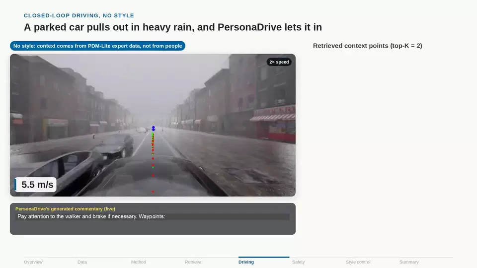</a><br>
<sub><b>Closed loop, heavy rain (no style).</b> A parked car pulls out and PersonaDrive lets it in. Right: the two retrieved context points that go into the prompt, updated every tick. Bottom: the commentary PersonaDrive generates.</sub>
</p>

## A style-instructed driving dataset

<table>
<tr>
<td width="58%">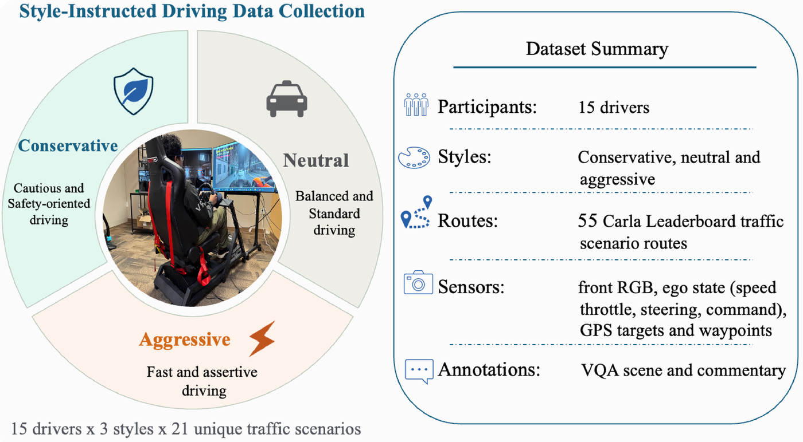</td>
<td width="42%">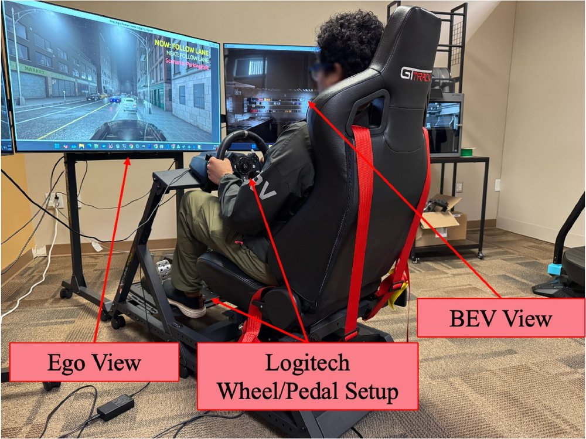</td>
</tr>
<tr>
<td><sub>Every participant drives each route three times, once per instruction. Each pass records front-view RGB, ego state (speed, throttle, steering, command), GPS targets and waypoints. VQA and commentary annotations are added afterwards.</sub></td>
<td><sub>Driver-in-the-loop rig: GTrack seat, three 50" monitors (~130°), Logitech G923 wheel and pedals. CARLA runs synchronously at 20 Hz.</sub></td>
</tr>
</table>

| Instruction given to the driver | Mean speed (mph) | In motion (mph) | Std. dev. | Stopped (%) |
|---|---:|---:|---:|---:|
| **Conservative**: *"Target 10–15 mph on surface streets and 25–35 mph on the highway; yield to other vehicles whenever possible."* | 9.8 | 11.5 | 7.6 | 14.6 |
| **Neutral**: *"Follow traffic laws, navigate safely, and drive at a reasonable speed."* | 13.2 | 15.6 | 10.8 | 15.7 |
| **Aggressive**: *"Drive as fast as possible without crashing; engage in aggressive behaviors such as tailgating and cutting off merging vehicles."* | 17.5 | 21.8 | 16.8 | 19.8 |

<sub>Speed statistics of the human data, route-matched over the 55 routes driven under all three instructions. The instructions separate before any model is involved. The dataset is on Hugging Face ([PervasiveAutonomyLab/PersonaDrive](https://huggingface.co/datasets/PervasiveAutonomyLab/PersonaDrive)); its layout is in [datasets/README.md](../datasets/README.md), and the code that recorded it is in [human_data_collection/](../human_data_collection/README.md).</sub>

## Results

All numbers are as published in the paper (Bench2Drive, 220 routes, closed loop). [Evaluation and the paper's tables](../README.md#evaluation-and-the-papers-tables) lists the script behind each table.

<table>
<tr><td valign="top" width="44%">

**Without style** (style-agnostic index)

| Method | DS ↑ | SR (%) ↑ |
|---|---:|---:|
| UniAD-Base | 45.81 | 16.36 |
| ThinkTwice | 62.44 | 31.23 |
| DriveAdapter | 64.22 | 33.08 |
| SimLingo | 85.07 ± 0.95 | 67.27 ± 2.11 |
| SimLingo-BASE | 85.94 | 66.82 |
| HiP-AD | 86.77 | 69.09 |
| **PersonaDrive** | **88.95** | **72.29** |

</td><td valign="top" width="56%">

**With style** (one checkpoint, per-style index)

| Method | Style | DS ↑ | Speed (m/s) | Accel. (m/s²) |
|---|---|---:|---:|---:|
| SimLingo (style prompt) | Cons. / Neut. / Aggr. | 78.18 / 78.15 / 78.56 | 7.21 / 7.37 / 7.66 | 5.29 / 5.22 / 5.39 |
| StyleDrive | Cons. / Neut. / Aggr. | 77.02 / 76.26 / 75.68 | 6.82 / 6.98 / 7.23 | 5.39 / 5.43 / 5.59 |
| DMW | Cons. / Neut. / Aggr. | 82.72 / 82.03 / 79.50 | 6.18 / 6.34 / 7.72 | 5.26 / 5.43 / 6.01 |
| **PersonaDrive** | Cons. / Neut. / Aggr. | **89.62 / 87.55 / 88.69** | 5.05 / 5.52 / 6.05 | 3.17 / 3.51 / 3.96 |

<sub>PersonaDrive's speed and acceleration rise in order from conservative to aggressive (+19.8 % / +24.9 %); SimLingo prompted with the style name changes speed by 6.2 % and its acceleration is not ordered.</sub>

</td></tr>
</table>

**Where the gain comes from** (additional ablation, not in the paper). SimLingo fine-tuned exactly like PersonaDrive (same routes, one epoch, same hyperparameters; [Stage 3b](../README.md#full-pipeline) with `data_module.base_dataset.use_icl=False`) but without retrieved demonstrations scores the same as SimLingo. The +3.9 DS gain therefore comes from retrieval, not from the extra fine-tuning.

| Method | Fine-tuned on PersonaDrive data | Retrieval | DS ↑ | SR (%) ↑ |
|---|:---:|:---:|---:|---:|
| SimLingo | – | – | 85.07 ± 0.95 | 67.27 ± 2.11 |
| SimLingo, fine-tuned without retrieval | ✓ | – | 85.08 | 66.36 |
| **PersonaDrive** | ✓ | ✓ | **88.95** | **72.29** |

<sub>Bench2Drive, 220 routes, one run.</sub>

<details>
<summary><b>Retrieval depth K</b> (same PersonaDrive checkpoint; K = 0 is the SimLingo backbone without retrieval)</summary>

| Metric | K = 0 | K = 1 | **K = 2** | K = 3 | K = 4 |
|---|---:|---:|---:|---:|---:|
| ADE (m) ↓ | 0.820 | 0.880 | 0.795 | 0.793 | 0.791 |
| FDE (m) ↓ | 1.787 | 1.961 | 1.699 | 1.650 | 1.648 |
| Driving Score ↑ | 85.07 | 81.55 | 88.95 | 89.16 | 89.30 |
| Success Rate (%) ↑ | 67.27 | 62.17 | 72.29 | 72.35 | 73.10 |
| Prompt tokens ↓ | 547 | 1292 | 2030 | 2769 | 3507 |
| Latency per tick (ms) ↓ | 480.3 | 509.6 | 557.7 | 599.4 | 649.7 |

Beyond K = 2, Driving Score and Success Rate are nearly flat while prompt length and latency keep growing. K = 2 adds 77.4 ms per tick over SimLingo and is the operating point used throughout.
</details>

<p align="center">
<a href="https://pervasiveautonomylab.github.io/personadrive-landpage/static/videos/safety_red_light.mp4">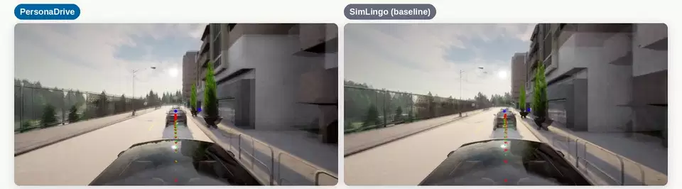</a><br>
<sub><b>Same route, red light (qualitative).</b> SimLingo turns right on red (<i>"Turn right. Accelerate to reach the speed limit."</i>); PersonaDrive stays stopped for the whole red phase (<i>"Follow the route. Remain stopped due to the red traffic light."</i>) and turns on green.</sub>
</p>

## About this repository

**This repository** is a fork of [SimLingo](https://github.com/RenzKa/simlingo) (CVPR 2025), which itself builds on [CARLA garage](https://github.com/autonomousvision/carla_garage). It contains:
- the full PersonaDrive pipeline;
- the trained retrieval head;
- one conda environment, captured from the one that trained and evaluated PersonaDrive;
- end-to-end tests;
- dataset packaging.
